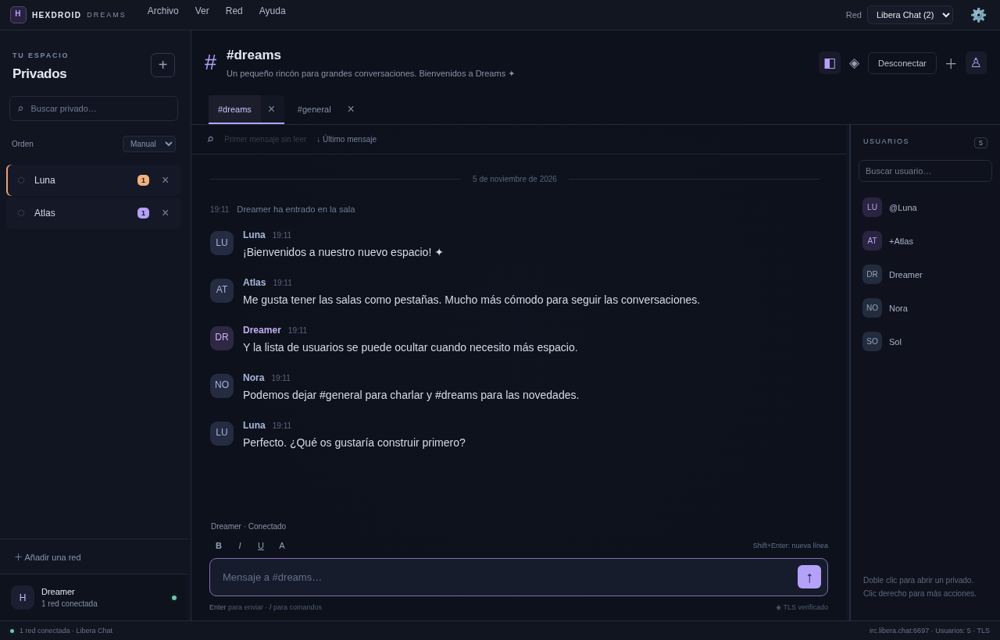

# HexDroid Dreams para Windows

Cliente IRC de escritorio creado desde cero. Versión de prueba con IRC y sistemas avanzados: **0.3.0**.

Este repositorio contiene exclusivamente el proyecto Windows activo. El proyecto Android está en [Malekira/HexDroid-Dreams-Android](https://github.com/Malekira/HexDroid-Dreams-Android).

**[Descargar la versión Windows](https://github.com/Malekira/HexDroid-Dreams-Windows/releases/tag/dreams-windows-v0.3.0)**

## Abrir en Windows

1. Extrae **todo** `HexDroid-Dreams-0.3.0-Windows-x64.zip` en una carpeta normal.
2. Abre `HexDroidDreams.exe` dentro de la carpeta extraída. No necesita MSI ni instalar Node.js.
3. Añade una red: servidor, puerto, TLS, apodo y, opcionalmente, salas de inicio.
4. Pulsa **Guardar y conectar**. Usa el botón **+** de la conversación para entrar en más salas.

Necesita Windows 10/11 de 64 bits. La distribución de prueba no está firmada digitalmente; Windows puede mostrar la advertencia de editor desconocido. El código fuente y sus dependencias fijadas se entregan para revisión. No desactives las protecciones de Windows.

Si no aparece la ventana, ejecuta `Iniciar-con-diagnostico.cmd`. La configuración y `startup.log` se guardan en `%APPDATA%\HexDroidDreams-Desktop`. El lanzador añade `launcher.log` allí. También puedes abrir esa carpeta desde **Archivo → Abrir carpeta de diagnóstico**. No hace falta eliminar tus datos ni reinstalar para obtener el registro. Esta carpeta es independiente del nombre del ejecutable y de las versiones anteriores.

## Interfaz de escritorio

- Privados exclusivamente a la izquierda, con búsqueda, orden manual/por nombre/sin leer, contadores y menciones. Su menú permite cerrar, marcar leído y silenciar el resaltado de actividad.
- Canales exclusivamente en las pestañas superiores, reordenables mediante arrastre o menú contextual; el orden y los silencios se conservan al reiniciar.
- Selector de red compacto en la barra superior. Canales, privados, borradores y posición de lectura permanecen separados por red, incluso con apodos o salas iguales.
- Ambos paneles laterales tienen divisores arrastrables, controles por teclado y botones para ocultarlos/restaurarlos. Se conservan los anchos preferidos y se adaptan temporalmente a ventanas pequeñas.
- Usuarios ordenados por los rangos anunciados, búsqueda, doble clic para privado y menú WHOIS/WHO/invitación/moderación. Las acciones privilegiadas se deshabilitan si el rango local no las autoriza; el servidor siempre decide si acepta una petición.
- Chat con formato IRC/mIRC y ANSI básico seguro, selección y copia de mensajes, búsqueda en los mensajes cargados, primer mensaje sin leer y salto al final. Fuente, tamaño, color del apodo propio, interlineado y separación configurables.
- Borradores y posiciones de lectura individuales durante la sesión, historial de lo escrito en memoria, completado con Tab, Enter para enviar y Shift+Enter para varias líneas.
- Ventana con tamaño/posición/maximización persistentes y recuperación si se desconecta un monitor. Configuración arriba a la derecha con búsqueda de opciones.

Atajos: **Ctrl+Tab / Ctrl+Shift+Tab** cambia de canal; **Ctrl+P** muestra/oculta privados; **Ctrl+U** muestra/oculta usuarios; **Ctrl+F** busca mensajes; **Ctrl+J** abre una sala; **Ctrl+N** añade red; **Ctrl+,** abre configuración. Selecciona mensajes con Ctrl+clic y copia con Ctrl+C.

Comandos disponibles: `/join`, `/part`, `/cycle`, `/nick`, `/query`, `/msg`, `/notice`, `/me`, `/whois`, `/who`, `/topic`, `/mode`, `/invite`, `/kick`, `/ban`, `/unban`, `/op`, `/deop`, `/voice`, `/devoice`, `/away`, `/back`, `/list`, `/time`, `/version`, `/motd`, `/admin`, `/info`, `/raw`, `/quote`, `/markread` y `/quit`. Para texto que empiece por `/`, escribe `//`.



## IRC y sistemas avanzados 0.3.0

El engranaje superior derecho y **Herramientas** abren redes/autenticación, historial, notificaciones/tema, DCC, cifrado, scripts, respaldos y multimedia. La interfaz de paneles de 0.2.0 se conserva.

- CAP/SASL (PLAIN, SCRAM-SHA-256, EXTERNAL), certificados PFX/CA, TLS verificado, STS, reconexión, recuperación de canales y nick, autojoin con claves, codificaciones, SOCKS4/5 y perfiles de bouncer.
- IRCv3 negociado: echo sin duplicación, lotes/multilínea, CHATHISTORY, respuestas, reacciones, escritura, marcas de lectura y eliminación compatibles. Filehost e iconos se detectan mediante ISUPPORT; los avatares requieren metadatos compatibles y descarga solicitada.
- SQLite/FTS opcional con búsqueda global, retención, carpeta y exportación TXT/ZIP; diagnóstico de protocolo cifrado y sin credenciales ni contenido de chat.
- Notificaciones nativas, bandeja y segundo plano; silencios y palabras destacadas; temas claro/oscuro/sistema/Matrix.
- DCC SEND/CHAT/SSEND/SCHAT, aceptación explícita, transferencia TLS verificada, envío pasivo, progreso, cancelación, puertos y reanudación.
- AGM, FiSH y AGE; claves e identidades en el almacén seguro, control de huellas y bloqueo de texto claro en destinos protegidos.
- Intérprete `.hex` aislado con alias, eventos, variables y colecciones, bucles, HTTP/JSON por dominio y permiso, vistas/botones y archivos seleccionados por el usuario. Sin `eval` ni acceso arbitrario al sistema de archivos.
- Respaldos con secretos cifrados opcionales; scripts restaurados desactivados.

Consulta [las notas y límites de esta versión](RELEASE-NOTES.md) y [el estado de las etapas](docs/IMPLEMENTATION.md). No es una versión estable ni una certificación de paridad con Android.

## Alcance y privacidad

El historial está desactivado por defecto. Al activarlo se guarda el contenido de las conversaciones en este equipo. Los borradores se conservan solo durante la sesión. Se mantienen hasta 600 mensajes cargados por conversación y 100 entradas de composición; la base de historial tiene su propia retención. No se descargan imágenes, avatares ni enlaces automáticamente.

Las contraseñas se mantienen en memoria salvo que marques guardar. En Windows se usa `safeStorage` de Electron respaldado por DPAPI; si el proveedor seguro no está disponible se rechaza guardar secretos, sin alternativa en texto claro. Las configuraciones anteriores conservan sus perfiles y disposición. Guarda un respaldo antes de probar cambios de cifrado o restauraciones.

DCC utiliza conexiones directas. DCC, HTTP de scripts y vistas previas se bloquean por defecto al usar proxy para evitar fugas de IP. Las claves compartidas deben intercambiarse por un canal seguro. AGE necesita validación cruzada con el cliente Android real; las pruebas entre componentes Windows no la sustituyen.

El binario sigue sin firma digital: la política ASR que bloqueó versiones anteriores puede bloquear también esta. El empaquetado no cambia las protecciones de Windows.

## Desarrollar

Usa el checkout existente; no es necesario crear otro worktree. Requiere Node.js 24 o posterior compatible y npm.

```sh
npm ci
npx install-electron --no
npm start
```

Electron descarga su runtime oficial en el primer uso. Se mantienen la verificación TLS y los checksums oficiales. Si tu entorno requiere proxy, Node.js 24 admite `NODE_USE_ENV_PROXY=1` junto a las variables de proxy correspondientes. No guardes credenciales en el proyecto.

```sh
npm test
npm run test:desktop
npm run test:ui
npm run build:win
node scripts/package-artifacts.js
```

`test:ui` utiliza Chromium en `/usr/bin/chromium` por defecto. En Windows configura `CHROMIUM_PATH` con la ruta de un Chrome/Chromium instalado. `test:desktop` usa el Electron real; en Linux añade únicamente para esta prueba las opciones de ejecución sin pantalla del entorno. La aplicación de Windows mantiene su sandbox normal.

El empaquetado genera `dist/HexDroidDreams-win32-x64/HexDroidDreams.exe`; distribuye toda la carpeta, no solo el ejecutable. `package-artifacts.js` añade el lanzador de diagnóstico y crea el ZIP mediante PowerShell en Windows o `zip` en Linux.

## Validación

`npm test` ejecuta 59 pruebas y comprueba protocolo, TLS/SASL, almacenamiento seguro, cifrado, DCC, scripts, multimedia y modelo de conversaciones. `npm run test:ui` comprueba 9 flujos en Chromium, incluido arrastre, ambos divisores, reapertura, aislamiento entre redes, borradores, menús, búsqueda y ráfagas de 900 mensajes. Su transporte está simulado explícitamente.

`npm run test:desktop` utiliza un perfil temporal explícito, separado de los datos personales, y ejecuta **Electron real** y un servidor IRC TCP local: mensajes, privados separados, borradores, líneas múltiples, WHOIS, modos, salida/reentrada de canales, ambos anchos, reapertura, geometría, instancia única y recuperación de configuración dañada. Los menús envían comandos reales por IPC y TCP.

GitHub Actions ejecuta núcleo, Electron y pruebas de interfaz en Windows antes de compilar/publicar versiones de prueba. Una compilación correcta no demuestra que cada red IRC o equipo Windows acepte la aplicación. **La conexión a una red IRC pública y la aceptación visual en el equipo del usuario requieren validación adicional.** Las capturas de pruebas contienen conversaciones simuladas.

El código Windows se mantiene en la rama `main` de [Malekira/HexDroid-Dreams-Windows](https://github.com/Malekira/HexDroid-Dreams-Windows). GitHub Actions compila y prueba Windows al actualizar esa rama. Sus versiones y descargas se publican en este mismo repositorio.

La versión 0.1.0 y su etiqueta conservan el commit y el ZIP originales de antes de la separación. La rama `legacy/windows-prototype` conserva el prototipo Windows anterior como referencia histórica.

La distribución se publica bajo GPL-3.0-or-later. Véanse [LICENSE](LICENSE) y [NOTICE](NOTICE) para la referencia a Android y los avisos de terceros.
